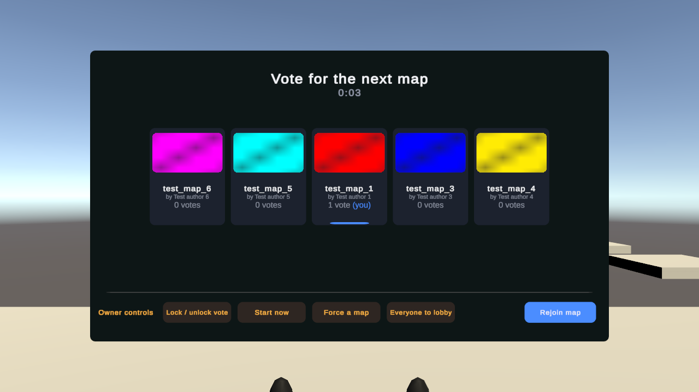
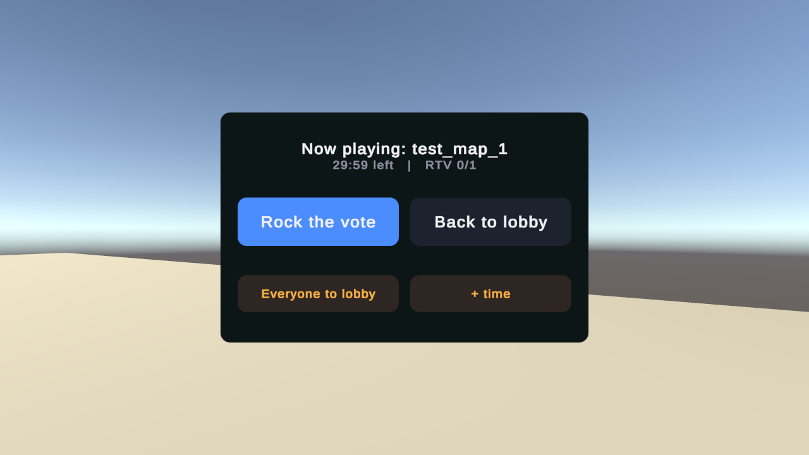

# Setup guide: a CS:S bhop world in VRChat

From an empty project to an uploaded VRChat world with Source movement, a run timer and a lobby where players vote
between imported CS:S bhop maps. Every setting is in the [settings reference](SETTINGS.md); back to the
[README](../README.md).

> [!NOTE]
> **Status (2026-10-11).** Done and tested in Unity with ClientSim: movement, timer, map import (collision, visuals,
> lightmaps, water, sky, sounds, bhop blocks, breakable glass, boosters, ladders), timer zones, map rotation with
> UI menus, practice courses, saved records.

## Contents

| Part | Steps |
|---|---|
| **A. Set up the project** | [1. What you need](#1-what-you-need) · [2. Create the project](#2-create-the-project) · [3. Add the packages](#3-add-the-packages) · [4. Install uSource](#4-install-usource) · [5. Get the maps](#5-get-the-maps) |
| **B. Build the world** | [6. Quick way: the sample world](#6-quick-way-the-sample-world) · [7. Manual way: one map at a time](#7-manual-way-one-map-at-a-time) · [8. Create the lobby](#8-create-the-lobby) · [9. Movement and timer](#9-movement-and-timer) |
| **C. Test and upload** | [10. Test in Unity](#10-test-in-unity) · [11. Upload](#11-upload) |
| **D. Reference** | [12. Playing it](#12-playing-it) · [13. What the import gives you](#13-what-the-import-gives-you) · [14. Troubleshooting](#14-troubleshooting) |

---

# A. Set up the project

## 1. What you need

| Item | Why |
|---|---|
| Windows PC | The Creator Companion and world uploads are Windows-first |
| VRChat account that can upload | Needs the "New User" trust rank or higher |
| [VRChat Creator Companion](https://vrchat.com/home/download) | Creates the Unity project with the VRChat SDK |
| Unity Hub + **Unity 2022.3.22f1** | The Creator Companion asks for this exact version |
| **Counter-Strike: Source** (Steam) | The maps use its stock textures, models and sounds |
| [This repository](https://github.com/bunnnyy/vrc-claude) | **Code > Download ZIP** |
| [uSource](https://github.com/DeadZoneLuna/uSource) | Converts the maps' visible geometry and textures ([step 4](#4-install-usource)) |

## 2. Create the project

1. Creator Companion: **Projects > Create New Project**.
2. Pick the **World** template (Udon, UdonSharp, ClientSim), name it, **Create Project**.
3. **Open Project** (the first start takes a few minutes).

## 3. Add the packages

1. Unzip this repository.
2. Copy `Assets/SourceMovement`, `Assets/SourceTimer` and `Assets/SourceMaps` **with the `.meta` files next to them**
   into your project's `Assets` (drag them into Unity's Project window).
3. Wait for the compile. On UdonSharp errors: **VRChat SDK > Udon Sharp > Compile All UdonSharp Programs**.
4. **Window > TextMeshPro > Import TMP Essential Resources** (the lobby tool also does this if it's missing).

> [!WARNING]
> Without TMP Essential Resources every text on the boards and menus is invisible.

## 4. Install uSource

uSource turns a map's geometry and textures into Unity meshes and materials. It was picked over Shane-SDK's USource:
it works with VRChat's render pipeline and lines up with the collision
([comparison](../Dev/docs/MAPVOTE_PLAN.md#step-2-converter-comparison)).

1. Download it (**Code > Download ZIP**) and unzip it into `Assets/uSource`.
2. Select `Assets/uSource/uSource.asmdef`, tick **Allow 'unsafe' Code**, **Apply**.

> [!IMPORTANT]
> uSource states no licence: use it for your own world and don't redistribute it.

## 5. Get the maps

Download from GameBanana, unzip (7-Zip opens .zip, .rar and .7z) and put the `.bsp` files in one folder.

| # | Map | Author | GameBanana |
|---|---|---|---|
| 1 | bhop_japan | Tony Montana | [mods/125304](https://gamebanana.com/mods/125304) |
| 2 | bhop_kitsune | Ghost1447951 | [mods/126424](https://gamebanana.com/mods/126424) |
| 3 | bhop_eazy_v2 | 31K4L | [mods/124915](https://gamebanana.com/mods/124915) |
| 4 | bhop_arcane_v1 | Panzerhandschuh | [mods/124461](https://gamebanana.com/mods/124461) |
| 5 | bhop_badges | Badges & fission | [mods/124524](https://gamebanana.com/mods/124524) |
| 6 | bhop_monster_jam | Aoki | [mods/125558](https://gamebanana.com/mods/125558) |

> [!IMPORTANT]
> The maps belong to their authors. For a **public** world, ask each author first and credit them (the vote menu
> shows the author).

---

# B. Build the world

## 6. Quick way: the sample world

1. **Tools > Source Maps > Build Sample World...**
2. Pick the folder with the `.bsp` files.
3. Pick your **Counter-Strike Source** folder, the one with `cstrike` and `hl2` in it, e.g.
   `C:\Program Files (x86)\Steam\steamapps\common\Counter-Strike Source` (asked once).
4. Continue at [step 9](#9-movement-and-timer).

It does steps 7 and 8 for every map: visuals, collision, markers, timer zones, a thumbnail from the spawn, the lobby
with practice courses and a records wall, saved as `Assets/SourceMapsSample.unity`.

## 7. Manual way: one map at a time

| # | Do | Result |
|---|---|---|
| 1 | **Tools > Source Maps > Import BSP...**, pick the `.bsp` | An object named after the map with collision, entity markers and working mechanics ([step 13](#13-what-the-import-gives-you)) |
| 2 | Move the map's object to a free spot | Each map needs its own place (up to ~620 m across; the sample world uses 700 m apart along X). Do this before visuals and zones |
| 3 | **Visuals**: easiest through the sample builder ([step 6](#6-quick-way-the-sample-world)). By hand: uSource's own window with **Unit scale 0.01905**, then drag its object under the map's | Builder: geometry, textures, lightmaps, water, sky, sounds. By hand: uSource's geometry and textures only |
| 4 | Select the map, **Tools > Source Maps > Import Timer Zones (srcwr) For Selected Map** | Start, end, stages as checkpoints and bonus tracks from [zones-cstrike](https://github.com/srcwr/zones-cstrike) |
| 5 | Select the map, **Tools > Source Maps > Add Selected Map To Rotation** | **Source Map Info** and a **Spawn** at the map's first player start |
| 6 | On **Source Map Info**: fill in **Author**, drag a **Thumbnail**; check the **Spawn** child | The vote card's credit and picture; where players arrive |

> [!TIP]
> No zones on zones-cstrike for your map? Add a Box Collider (Is Trigger) + **Timer Zone**, type Start/End. Name the
> start zone "Start &lt;map name&gt;" so it gets boards.

## 8. Create the lobby

**Tools > Source Maps > Create Lobby** builds it at the scene origin, using every map from step 7. Run it again
whenever you add a map (it replaces the old lobby).

| Part | What it is |
|---|---|
| Vote menu | One card per map (thumbnail, name, author, votes; your vote has a blue bar), owner controls in amber, **Rejoin map** |
| Map panels | A small menu next to each map's spawn: time left, **Rock the vote**, **Back to lobby**, owner controls |
| Practice courses | A short bhop lane and a small surf ramp, each with legit and auto-bhop boards |
| Records wall | A legit and an auto-bhop board for every course with a "Start &lt;course&gt;" zone |
| World spawn | Moved into the lobby; the respawn height is lowered below the deepest map |

The menus are UI: point and click (VRChat's laser in VR, the mouse on desktop). Only one map is active at a time:
everyone plays the winner, **Back to lobby** leaves it, **Rejoin map** goes back in.

> [!NOTE]
> Worlds built before 2026-10-11 have cube buttons: run **Create Lobby** again to get the menus.

**SourceMapManager** settings (under "SourceMaps Lobby"):

| Setting | Default | What it does |
|---|---|---|
| Choices | 5 | Maps offered per vote (2-6), random, never the map just played |
| Vote Seconds | 60 | From the first vote to the result |
| Rtv Ratio | 0.6 | Share of players needed to rock the vote |
| Time Limit Minutes | 30 | Then a new vote with "extend" offered. **0 = rock the vote only** |
| Extend Minutes | 15 | Added when "extend" wins or the owner presses "+ time" |

## 9. Movement and timer

| # | Do | Why |
|---|---|---|
| 1 | Drag `Assets/SourceMovement/SourceMovement.prefab` into the scene **before** Create Lobby (or run it again after) | Practice boards split auto and legit bhop, and **Hull Only** gets every map |
| 2 | Nothing: Create Lobby adds `SourceTimer.prefab` if missing | The run timer |
| 3 | Check **Hull Only** on SourceMovement lists your maps | VRChat's capsule (84 units, doesn't shrink when ducking) would snag under low ceilings and in vents; with this only the CS:S hull collides there |

> [!NOTE]
> **Saved records** (boards with a **Save Key**) use VRChat Persistence, which is per player: a board shows the bests
> of everyone who has been in this instance, including their bests from earlier visits. There is no world-wide
> all-time board.

---

# C. Test and upload

## 10. Test in Unity

1. Press **Play**: ClientSim starts you in the lobby, as instance owner (you see the owner controls).
2. Point at a map card with the mouse and left-click to vote; the timer starts with the first vote.

## 11. Upload

1. **VRChat SDK > Show Control Panel**, sign in, **Builder** tab.
2. Platform: **Windows** only (the maps are too big for Quest/Android).
3. **Build and Upload**, and check the world size it reports.

---

# D. Reference

## 12. Playing it

| Thing | How |
|---|---|
| Vote | Click a map card; click another to change. Ends 60 s after the first vote, ties at random, everyone goes to the winner |
| Rock the vote | On the map's menu; click again to take it back. At 60% of players a new vote starts in the lobby |
| Lobby / rejoin | **Back to lobby** takes only you; **Rejoin map** on the vote menu takes you back in |
| Time limit | When it runs out everyone returns for a vote that also offers "Extend" |
| Ducking | Hold **Left Ctrl** or VRChat's crouch (**C**, or crouch in VR). Crouch jumps reach 65-unit ledges; ducked you fit 46+ unit gaps |
| Practice courses | Green start pad to red end pad; falling sends you back, **G** restarts |
| Glass doors | bhop_eazy_v2's red lanes: the glass breaks as you get close (as if knifed), for you only, until you leave |
| Owner controls | Instance owner (else the master): **Lock / unlock vote** (only Start ends it), **Start now**, **Force a map** (then click a map), **Everyone to lobby**, **+ time** in maps |

## 13. What the import gives you

**Gameplay** (Import BSP):

| Feature | Like CS:S because |
|---|---|
| Collision | Every solid surface incl. invisible clip brushes; faces where two brushes touch are dropped (they'd stop surfers) |
| Entity markers | One per map entity with all its settings |
| Fall teleports, pushes, boosters, water, ladders | Working, for SourceMovement |
| Bhop blocks | Stand on one too long and you're sent back. Name-filtered teleports (japan, arcane, badges) and sinking `func_door` blocks (eazy_v2, monster_jam). Per player. Untick **On** on the map's **Bhop Blocks** for plain platforms |
| Breakable glass | Upright `func_breakable` (≤ 15 health) and `func_breakable_surf` break within knife reach (48 units), for you only, until you leave. Needs **Hull Only** |
| Trigger reach | Triggers are widened so VRChat's thinner capsule touches them where CS:S's 32-unit box would |

**Visuals** (uSource + `SourceMapVisuals`):

| Feature | How |
|---|---|
| Lightmaps | The map's own Source lightmaps on `SourceMaps/Lightmapped` (texture × lightmap), saved in `Assets/SourceMapsImported/<map>/Lightmaps`. Nothing to bake |
| Detail and see-through surfaces | Detail textures, decals and tree cards use the lightmaps too |
| Shadows | Only the lightmaps' own: the map neither casts nor gets Unity's real-time shadows |
| Props | Lit like CS:S lights models: ambient light at the prop plus the strongest lights reaching it (`SourceMaps/Prop`) |
| Water | `SourceMaps/Water`: the water's own colour (`$fogcolor`) with the sky reflected at low angles |
| Sky | The map's `skyname` as `<map>_sky.mat`, shown while you're in that map; the lobby keeps the world's sky |
| Sky faces | The `toolsskybox` walls draw the sky and hide what's behind them, so other stages don't show through |
| Sounds and music | Each `ambient_generic` is an Audio Source heard within its radius (areas have their own music); loops, start-silent and play-everywhere as in CS:S; triggers that play them work |

## 14. Troubleshooting

| # | Problem | Fix |
|---|---|---|
| 1 | Players fall through a map | Run **Import BSP** ([step 7.1](#7-manual-way-one-map-at-a-time)): uSource's visuals have no collision |
| 2 | Map looks white | Set the CS:S folder (with `cstrike` and `hl2`) and import again: materials saved without textures are rebuilt |
| 3 | Map looks pink | Shader problem: import the map again |
| 4 | Black walls, floors or water | Imported before 2026-10-11: import the map again |
| 5 | Another stage shows through the sky | Imported before 2026-10-11: import the map again |
| 6 | Sky is the world's default | The sky's textures weren't found (HL2 skies need the `hl2` folder): import again |
| 7 | No music or sounds | Sounds come from the map or your CS:S folder; you hear an area's sound only within its radius |
| 8 | Two maps overlap | Move the map objects apart ([step 7.2](#7-manual-way-one-map-at-a-time)) |
| 9 | Can't click the menus | Use VRChat's pointer (laser in VR, mouse on desktop). In your own test project the scripting defines must include `UDON` (the SDK adds it when Unity opens) |
| 10 | Owner controls don't show | Only the instance owner sees them; in public/group instances, the master |
